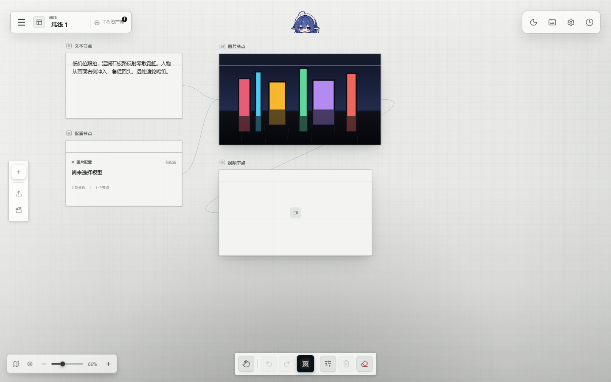
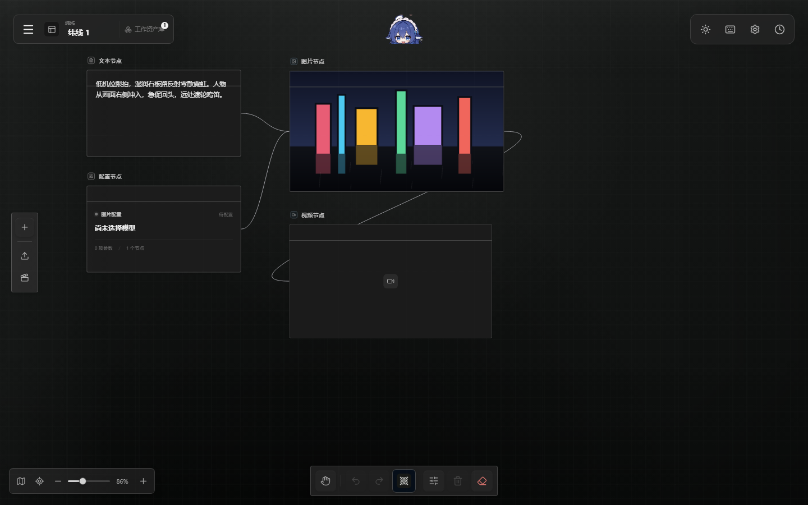
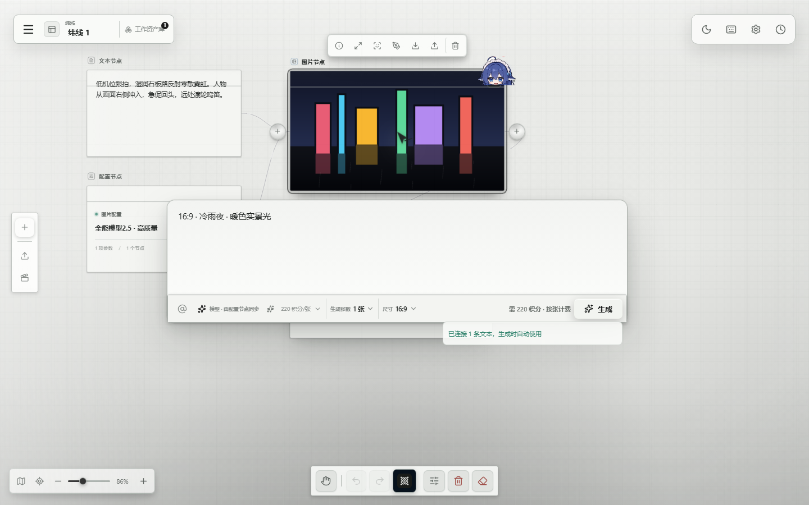
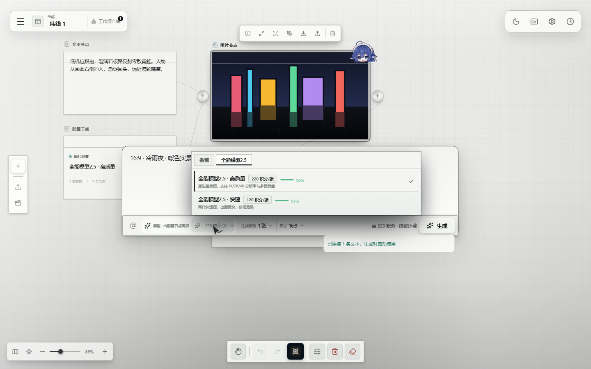
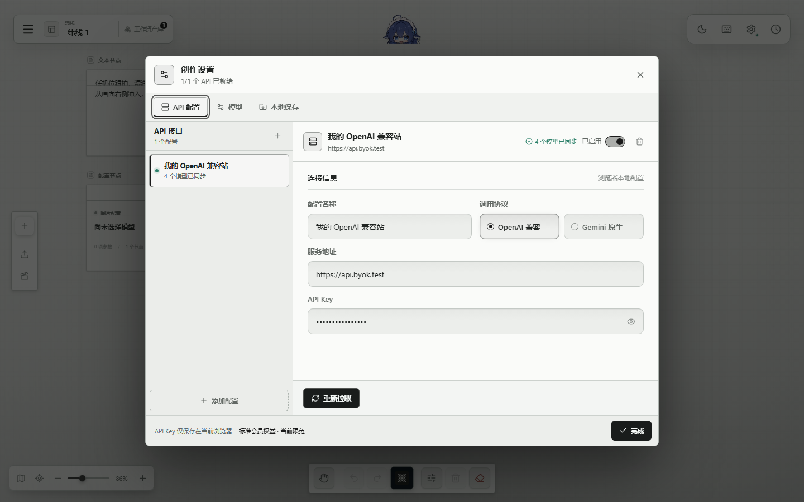
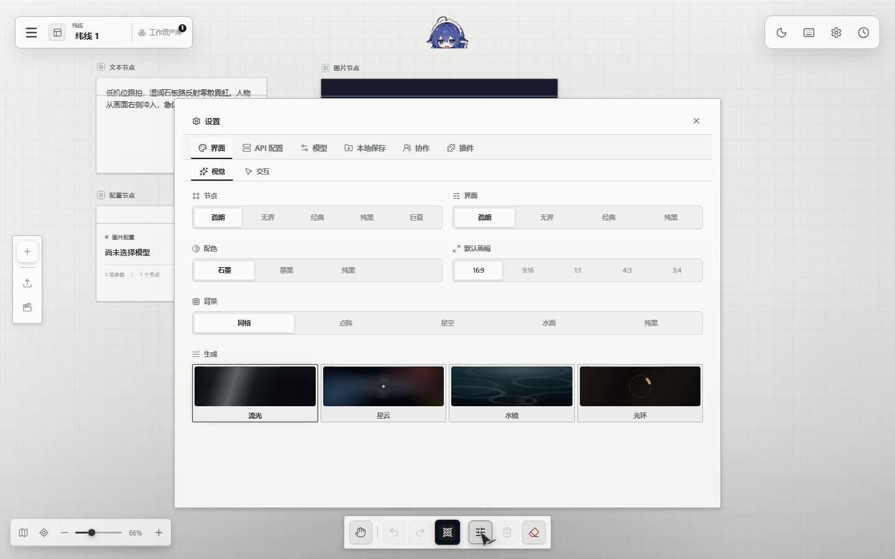
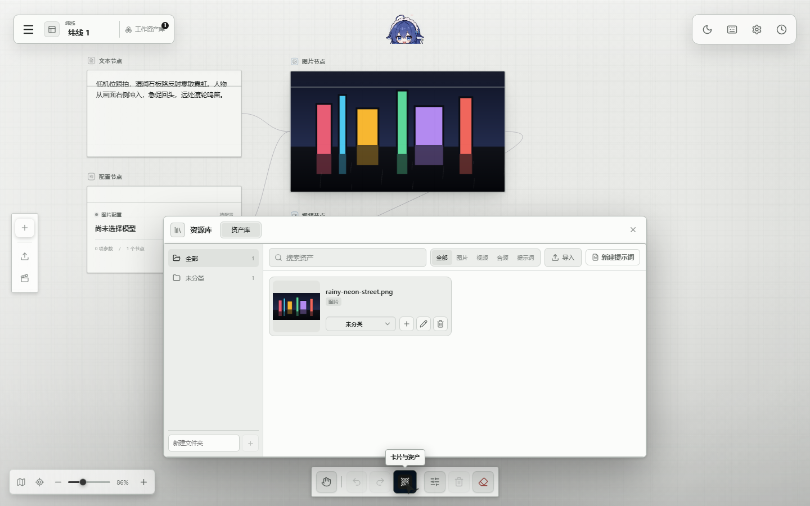
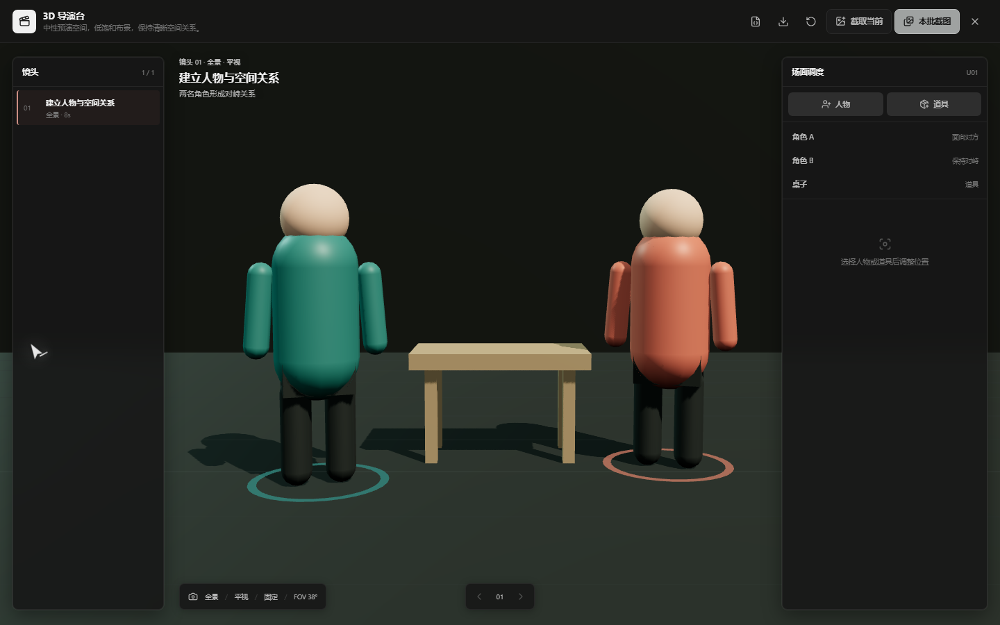
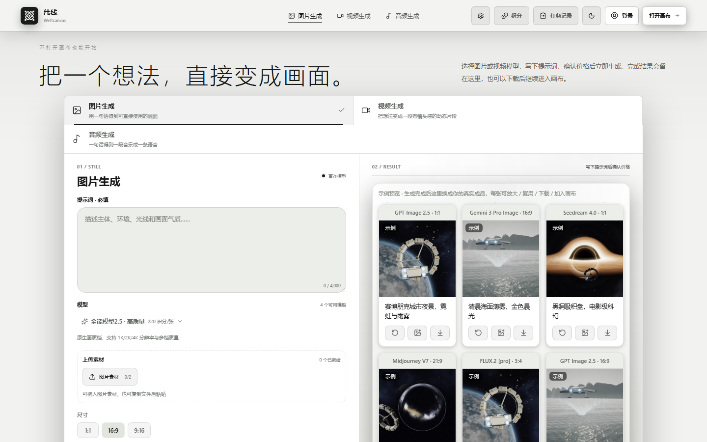
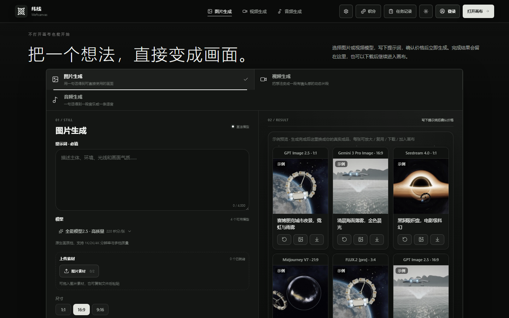

# 纬线无线画布（Weftcanvas）

面向 AI 创作的自托管无限画布——画布本身叫「**纬线**」。节点编排、自带 Key 直连模型、
Agent 连接器、持久化生成队列；画布数据默认留在你自己的浏览器里。

**在线预览**：<https://canvas.prompt-hubs.com>（官方托管实例，额外含云端钱包与卡片库；
本项目自身可 Docker 一键自托管，见下）。

> **状态（2026-10-14）**：核心画布、BYOK、Agent 连接器、自托管配方已就绪；
> 演示 GIF 与独立文档站待补。本 README 如实描述当前范围，不做完成度粉饰。

## 预览

白天（石墨）与黑夜（墨黑）两套配色，同一份画布：

| 石墨 · 白天                                    | 墨黑 · 黑夜                                   |
| ---------------------------------------------- | --------------------------------------------- |
|  |  |

**节点生成面板**——选中节点即开，模型、参数、价格一目了然；角落里的蓝发少女（白色是头饰）
是可拖拽的 Agent 伙伴，点哪个节点她就坐到哪个节点上：



**模型选择器**——按厂商/系列分类，每个模型带简介与服务端聚合的真实成功率（能量条）：



**BYOK 外接 API**——填自己的 OpenAI 兼容或 Gemini 原生端点，请求由浏览器直发、Key 只落本机；
支持多份配置、拉取上游模型目录：



**外观与样式**——节点/界面风格、配色（石墨 / 墨黑 / 纯黑）、背景（网格 / 点阵 / 星空 / 水面）、
生成特效、默认画幅，逐项可换：



**资产库**——本地素材、提示词、分类管理，拖进画布即用：



**3D 导演台**——Three.js 预演空间：摆人物道具、定机位、逐镜头截图回画布：



**直出工作台**——不开画布也能生成，明暗双主题：

| 白天                                                        | 黑夜                                                       |
| ----------------------------------------------------------- | ---------------------------------------------------------- |
|  |  |

## 开源范围

**包含**：

- 画布核心：节点、连线、磁性端口、分组、撤销重做、小屏地图、指针反馈、
  两种配色（石墨 / 墨黑）、Three.js 导演台。
- 本地优先的项目库：项目存 localStorage、媒体存 IndexedDB，断网可编辑。
- BYOK 直连：在设置里填自己的 OpenAI 兼容或 Gemini 端点，请求由浏览器直发，
  Key 只落在本机 `localStorage`，不经过任何我们的服务。
- Agent：右侧回复工作区 + 本地连接器（Codex 走 MCP 操作当前画布、Blender 走
  `weftcanvas_bridge` 插件）。
- 生成任务的持久化 worker（PostgreSQL 队列、租约与 fencing）。
- 自托管配方：`Dockerfile` + `docker-compose.yml`，一键起 `web + api + postgres`
  （见 [`docs/DEPLOYING.md`](docs/DEPLOYING.md)）。

**不包含**（商业版持有，开源仓库里没有）：

- 卡片库 / 社区 feed（数据源是私有服务）。
- 云端钱包、会员、兑换码、模型目录计价映射。
- 私有 Agent 系统提示词、检索与蒸馏知识、生产运维脚本。

## 快速开始

### 一键自托管（Docker）

```bash
{ echo "POSTGRES_PASSWORD=$(openssl rand -hex 16)"; \
  echo "IDENTITY_SESSION_SECRET=$(openssl rand -hex 32)"; } > .env
docker compose up --build -d      # http://127.0.0.1:8080
```

细节（worker profile、反向代理、更新）见 [`docs/DEPLOYING.md`](docs/DEPLOYING.md)。

### 本地开发

```bash
pnpm install
pnpm dev          # Web http://127.0.0.1:4173 · API http://127.0.0.1:8787
pnpm dev:agent    # 可选：Agent 运行时 http://127.0.0.1:8790
pnpm typecheck
pnpm test
pnpm test:e2e     # Playwright
```

首次打开后进入右上角设置，填入自己的 `Base URL` 与 `API Key` 即可开始生成。
需要 PostgreSQL 的能力（云项目、任务队列）要求 `DATABASE_URL` 与已应用的迁移；
只用本地画布与 BYOK 时不需要数据库。

## 数据与隐私

- 项目与媒体默认只在本机浏览器：项目 localStorage、媒体 IndexedDB。
- BYOK 的 Key 只存在你浏览器的 `localStorage`，不会进入仓库、fixture、
  项目 JSON 或我们的任何服务。
- 仓库不含任何真实凭据、私有提示词或私有模型映射。

## 许可

- **AGPL-3.0**（见 [LICENSE](LICENSE)）：可以自由使用、修改、分发，包括商用；
  但如果你把它作为网络服务提供给第三方，需要按 AGPL-3.0 第 13 条提供对应源码。
- **闭源商用**：如果你的产品不能开源，可以购买商业授权免除 AGPL 义务，
  见 [COMMERCIAL-LICENSE.md](COMMERCIAL-LICENSE.md)。

## 参与

见 [CONTRIBUTING.md](CONTRIBUTING.md)（开发环境、四个必跑命令、画布手感红线、CLA）；
安全问题见 [SECURITY.md](SECURITY.md)。

**交流**：QQ 群 **743378399**——用法答疑、插件与协议适配讨论、首发公告都在这。
商务授权与安全问题邮件 **2705367723@qq.com**（见
[COMMERCIAL-LICENSE.md](COMMERCIAL-LICENSE.md) / [SECURITY.md](SECURITY.md)）。

## 来源与致谢

本项目是独立实现（clean-origin），不是任何其他画布项目的 fork；设计上参考了同类
开源产品的交互与工程实践。来源登记见 [PROVENANCE.md](PROVENANCE.md)，第三方许可见
[NOTICE.md](NOTICE.md)；发布前已按 PROVENANCE 清单跑过相似度扫描取证。
