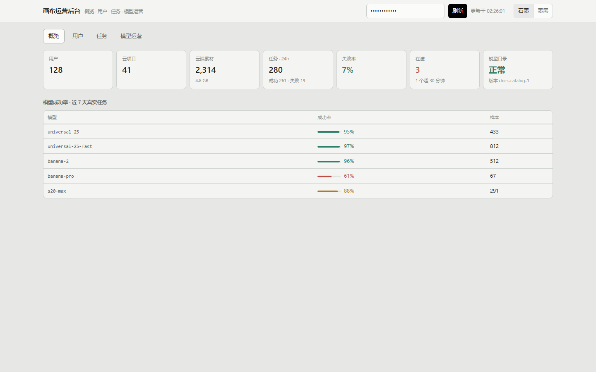
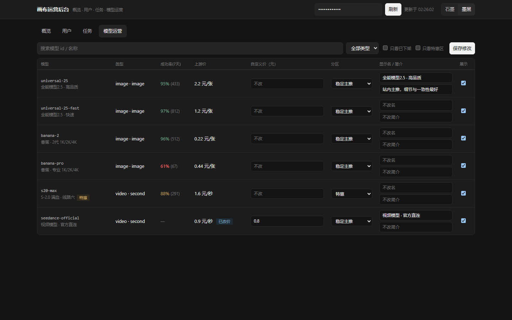

# Weftcanvas 纬线 · 可直接连接中转站的开源 AI 画布

填入中转站地址和自己的 API Key，在无限画布里连接文本、图片、视频与音频节点。
支持拉取上游模型列表、常见模型识别和可配置的接入协议；项目与素材默认保存在本机浏览器。

[](https://github.com/study666-creme/weftcanvas/actions/workflows/ci.yml)
[](LICENSE)

[快速开始](#快速开始) · [连接中转站](docs/CONNECTING-RELAYS.md) ·
[自托管](docs/DEPLOYING.md) · [文档索引](docs/README.md) · [商业授权](COMMERCIAL-LICENSE.md)

**在线预览**：[官方托管实例](https://canvas.prompt-hubs.com)（含云端钱包与卡片库，功能范围与开源版有差异）。

> **开发者预览**：适合本地创作和接入验证。中转站需要允许浏览器跨域请求，
> 模型执行协议需要匹配或通过高级协议配置。模型列表更新不保证每个模型都能直接调用。

## 连接你的中转站

1. 打开画布设置 → **API 配置** → **添加配置**。
2. 填入服务地址和自己的 Key，选择 OpenAI 兼容或 Gemini 原生协议，点击 **拉取模型**。
3. 在节点生成面板选择模型并生成；未识别的模型可手动标注模态，协议差异可在 **高级协议**中配置。

| 接入方式           | 需要提供                                               | 能获得什么                                                                 |
| ------------------ | ------------------------------------------------------ | -------------------------------------------------------------------------- |
| 浏览器直连（BYOK） | 中转站地址、Key、可读取的模型列表                      | 常见模型识别、多配置、模型选择与直接调用；可配置认证、端点、轮询和响应路径 |
| 合同目录（可选）   | 满足 [上游契约](docs/UPSTREAM-CONTRACT.md) 的目录 JSON | 上游声明的参数、模态、价格与可用性；服务端生成还需单独配置 worker          |

目录按新鲜度窗口刷新，新上架和下架模型会显示变化。识别规则是默认配置，
各中转站对同一模型的端点和参数可能不同，具体接入与排错见 [连接指南](docs/CONNECTING-RELAYS.md)。
**解析自检**离线处理粘贴的 JSON；**测试请求**会真实调用文本模型，可能按中转站规则计费。

## 预览

白天（石墨）与黑夜（墨黑）两套配色，同一份画布：

| 石墨 · 白天                                    | 墨黑 · 黑夜                                   |
| ---------------------------------------------- | --------------------------------------------- |
|  |  |

**节点生成面板**——选中节点即开，模型、参数、价格一目了然；角落里的蓝发少女（白色是头饰）
是可拖拽的 Agent 伙伴，平时待在画布上方的默认位，输入框打开时她趴到输入框的右上角：


**模型选择器**——按厂商/系列分类，每个模型带简介与服务端聚合的真实成功率（能量条）：


**BYOK 外接 API**——填自己的 OpenAI 兼容或 Gemini 原生端点，请求由浏览器直发、Key 只落本机；
支持多份配置、拉取上游模型目录：


**外观与样式**——节点/界面风格、配色（石墨 / 墨黑 / 纯黑）、背景（网格 / 点阵 / 星空 / 水面）、
生成特效、默认画幅，逐项可换：


**资产库**——本地素材、提示词、分类管理，拖进画布即用：


**3D 导演台**——Three.js 预演空间：摆人物道具、定机位、逐镜头截图回画布：


**直出工作台**——不开画布也能生成，明暗双主题：

| 白天                                                        | 黑夜                                                       |
| ----------------------------------------------------------- | ---------------------------------------------------------- |
|  |  |

## 运营后台

自托管部署自带一个和画布同一套配色的运营控制台：设置 `CANVAS_OPS_ADMIN_SECRET`
后打开 API 主机 + `/admin/ops`，输入运营密钥即用，配色在石墨 / 墨黑之间一键切换，
窄屏也能开。

- **概览**：用户、云项目、素材占用、24 小时任务成败、队列积压、目录新鲜度，
  以及近 7 天模型成功率（真实任务聚合）。
- **用户**：按邮箱、昵称或用户 id 搜索，逐行给出积分余额、云项目、素材占用与
  24 小时任务量。
- **任务**：失败的生成任务与错误码，按更新时间倒序。
- **模型运营**：默认跟随上游目录；需要时在这里做本地覆盖——上下架、自定义价
  （固定 / 分辨率分档 / token 双费率）、稳定 / 特惠分区、站内显示名与简介。
  上游价只读展示供对照，改过价的模型带「已改价」标记，保存即生效。

概览、用户与任务页读数据库（自托管 compose 已带 PostgreSQL）；模型运营走文件存储，
没有数据库也能用。同一套覆盖接口也有独立页 `/admin/model-overrides`，方便嵌进已有的
运营后台。

| 概览（石墨）                                      | 模型运营（墨黑）                             |
| ------------------------------------------------- | -------------------------------------------- |
|  |  |

## 开源范围

**包含**：

- 画布核心：节点、连线、磁性端口、分组、撤销重做、小屏地图、指针反馈、
  两种配色（石墨 / 墨黑）、Three.js 导演台。
- 本地优先的项目库：项目存 localStorage、媒体存 IndexedDB，断网可编辑。
- BYOK 直连：在设置里填自己的 OpenAI 兼容或 Gemini 端点，请求由浏览器直发，
  Key 保存在本机 `localStorage`，调用时发给你配置的上游。可接入提供兼容 API 的中转站，
  包含模型识别与高级协议配置；需要精确参数与
  渠道可用性时再按 `UPSTREAM-CONTRACT.md` 发布一份目录 JSON。
- Agent：右侧回复工作区 + 本地连接器（Codex 走 MCP 操作当前画布、Blender 走
  `weftcanvas_bridge` 插件）。
- 运营后台：`/admin/ops` 概览 / 用户目录 / 任务排查 / 模型上架与定价，与画布同一套
  配色（石墨 / 墨黑）。
- 生成任务的持久化 worker（PostgreSQL 队列、租约与 fencing）。
- 自托管配方：`Dockerfile` + `docker-compose.yml`，部署 `web + api + postgres`
  （见 [`docs/DEPLOYING.md`](docs/DEPLOYING.md)）。

**不包含**（商业版持有，开源仓库里没有）：

- 卡片库 / 社区 feed（数据源是私有服务）。
- 云端钱包、会员、兑换码、模型目录计价映射。
- 私有 Agent 系统提示词、检索与蒸馏知识、生产运维脚本。

## 快速开始

### 先体验画布（无数据库）

要求 Node.js 22 LTS 与仓库 `packageManager` 指定的 pnpm 版本。

```bash
git clone https://github.com/study666-creme/weftcanvas.git
cd weftcanvas
corepack enable
pnpm install --frozen-lockfile
pnpm dev:web     # http://127.0.0.1:4173
```

只用本地项目和浏览器 BYOK 时不需要 PostgreSQL。登录、云项目与持久化任务需要 API 和数据库。

### 自托管（Docker）

```bash
{ echo "POSTGRES_PASSWORD=$(openssl rand -hex 16)"; \
  echo "IDENTITY_SESSION_SECRET=$(openssl rand -hex 32)"; } > .env
docker compose up --build -d      # http://127.0.0.1:8080
```

细节（worker profile、反向代理、更新）见 [`docs/DEPLOYING.md`](docs/DEPLOYING.md)。

### 本地开发

```bash
pnpm install
pnpm dev          # Web http://127.0.0.1:4173 · API http://127.0.0.1:8787
pnpm dev:agent    # 可选：Agent 运行时 http://127.0.0.1:8790
pnpm typecheck
pnpm test
pnpm test:e2e     # Playwright
```

首次打开后按上面的连接步骤配置中转站，并确认模型协议与浏览器跨域访问可用。
需要 PostgreSQL 的能力（云项目、任务队列）要求 `DATABASE_URL` 与已应用的迁移；
只用本地画布与 BYOK 时不需要数据库。

## 数据与隐私

- 项目与媒体默认只在本机浏览器：项目 localStorage、媒体 IndexedDB。
- 项目 JSON 导出包含结构和媒体引用，不包含媒体文件；换浏览器前请另行备份素材。
- BYOK 的 Key 只存在你浏览器的 `localStorage`，不会进入仓库、fixture、
  项目 JSON 或 Canvas API；调用时发送给你选择的上游服务。
- 仓库不含任何真实凭据、私有提示词或私有模型映射。

## 许可

- **AGPL-3.0**（见 [LICENSE](LICENSE)）：可以自由使用、修改、分发，包括商用；
  但如果你把它作为网络服务提供给第三方，需要按 AGPL-3.0 第 13 条提供对应源码。
- **闭源商用**：如果你的产品不能开源，可以购买商业授权免除 AGPL 义务，
  见 [COMMERCIAL-LICENSE.md](COMMERCIAL-LICENSE.md)。

## 参与

见 [CONTRIBUTING.md](CONTRIBUTING.md)（开发环境、验证命令、画布手感约束与 CLA）；
安全问题见 [SECURITY.md](SECURITY.md)。

**交流**：QQ 群 **743378399**——用法答疑、插件与协议适配讨论、首发公告都在这。
商务授权与安全问题邮件 **2705367723@qq.com**（见
[COMMERCIAL-LICENSE.md](COMMERCIAL-LICENSE.md) / [SECURITY.md](SECURITY.md)）。

## 来源与致谢

本项目是独立实现（clean-origin），不是任何其他画布项目的 fork；设计上参考了同类
开源产品的交互与工程实践。来源登记见 [PROVENANCE.md](PROVENANCE.md)，第三方许可见
[NOTICE.md](NOTICE.md)；发布前已按 PROVENANCE 清单跑过相似度扫描取证。
